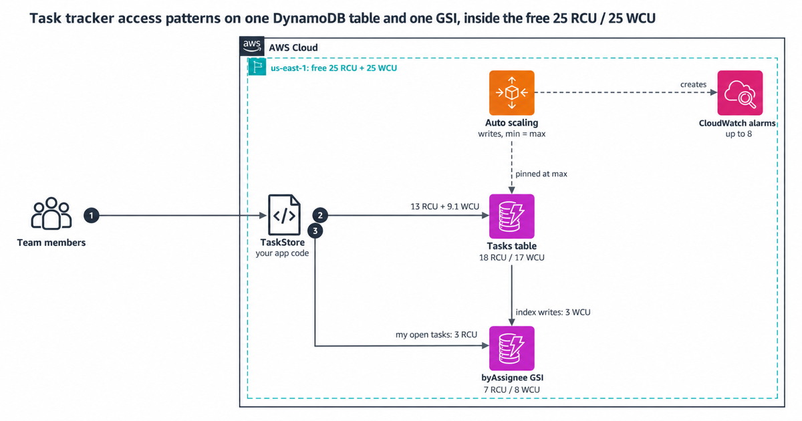

# Design DynamoDB to stay in the always-free tier

Amazon DynamoDB's always-free tier gives you 25 read capacity units (RCU) and 25 write capacity units (WCU) of provisioned capacity, plus 25 GB of storage, per AWS Region and per payer account. This repo is a small multi-tenant task tracker built on one table and one global secondary index (GSI), sized so the most capacity it can ever provision is 25 RCU and 25 WCU.

It's written in AWS CDK (TypeScript). The tests run every access pattern against DynamoDB Local, measure the capacity each one uses, and check that the designed peak workload fits.

## Architecture



## The capacity plan

Every provisioned table and GSI in the Region draws from the same 25 units, so the plan splits them:

| Resource | Reads (RCU) | Writes (WCU) | Peak need (reads / writes) |
|---|---|---|---|
| Table | 18, fixed | 17, auto scaling pinned at 17 | 13 / 9.1 |
| `byAssignee` GSI | 7, fixed | 8, auto scaling pinned at 8 | 3 / 3 |
| **Total** | **25** | **25** | |

The plan lives in [src/capacity-plan.ts](src/capacity-plan.ts). The stack refuses to synthesize if the totals pass 25.

If you already have another provisioned table in the same Region, it shares these 25 units. Shrink the plan before you deploy.

## Access patterns

| Pattern | Operation | Cost per call |
|---|---|---|
| Open a task | `GetItem`, eventually consistent | 0.5 RCU |
| List a project's tasks (30) | `Query` on the table | 2.5 RCU |
| My open tasks (20) | `Query` on the GSI | 0.5 RCU on the GSI |
| List projects, recent activity | `Query` on the table | 0.5 RCU each |
| Create a task | `PutItem` | 1 WCU + 1 WCU on the GSI |
| Start a task | `UpdateItem` | 1 WCU, nothing on the GSI |
| Finish a task | `UpdateItem` | 1 WCU + 1 WCU on the GSI |
| Reassign a task | `UpdateItem` | 1 WCU + 2 WCU on the GSI |
| Record activity | `PutItem` with a 30-day TTL | 1 WCU |

We measured each cost against DynamoDB Local, and each one matches the calculator in [src/capacity.ts](src/capacity.ts). [docs/design.md](docs/design.md) explains the key layout and why each pattern costs what it does.

## Run it

You need Node.js 24 and npm. The integration tests also need Docker.

```bash
npm ci
npm run check     # type check, lint, unit and template tests, synth with cdk-nag
npm run budget    # prints the capacity budget for the workload in src/workload.ts
```

To run the access patterns against DynamoDB Local:

```bash
docker run -d --rm -p 8013:8000 amazon/dynamodb-local:3.3.2
AWS_ENDPOINT_URL_DYNAMODB=http://localhost:8013 npm run test:int
```

## Deploy

You need AWS credentials and a CDK-bootstrapped account.

```bash
npm run deploy
```

The stack prints `TableName`. It creates the table and nothing else, so there's no function or API. Wire the `TaskStore` class into your own handlers.

## Tests

| Command | What runs | Needs |
|---|---|---|
| `npm test` | Calculator, workload budget, key layout, CDK template and cdk-nag tests | Nothing |
| `npm run test:int` | Every access pattern against DynamoDB Local, with consumed capacity measured | Docker |

We broke each key safeguard once on purpose: a read with `ConsistentRead: true`, a GSI that projects all attributes, a higher auto scaling max, status in the index key, and five more. A test failed every time, and [CONTRIBUTING.md](CONTRIBUTING.md) lists which one caught what.

## Cost

At the plan's size, capacity and storage cost $0 while the table stays under 25 GB and nothing else in the Region uses provisioned capacity. Two things can still bill: CloudWatch alarms that auto scaling creates, and point-in-time recovery if you turn it on. The numbers for both are in [docs/cost.md](docs/cost.md), along with when on-demand is cheaper.

## More docs

- [docs/design.md](docs/design.md): key layout, the GSI, TTL and the capacity math
- [docs/cost.md](docs/cost.md): what's free, what isn't, and when on-demand is cheaper
- [docs/runbook.md](docs/runbook.md): what to do when requests get throttled

## Clean up

```bash
npm run destroy
```

The table has deletion protection and a retain policy, so the stack delete leaves it in place. Turn off deletion protection and delete it in the DynamoDB console when you're sure. Then check CloudWatch for leftover auto scaling alarms, because deleting a table doesn't remove them.

---

Created by Rahul Ladumor / InfraTales, under the MIT-0 license
